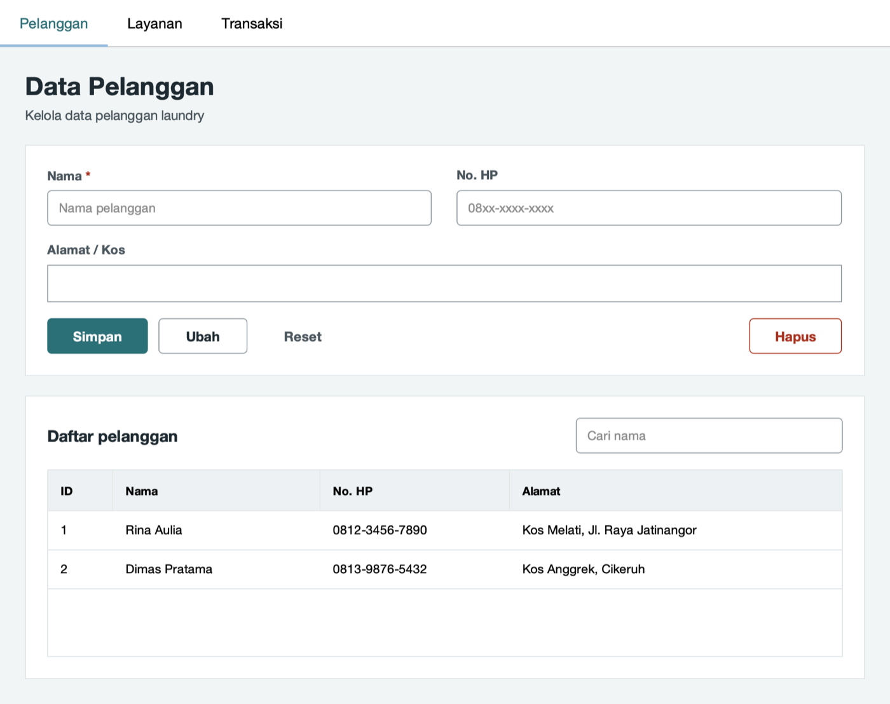
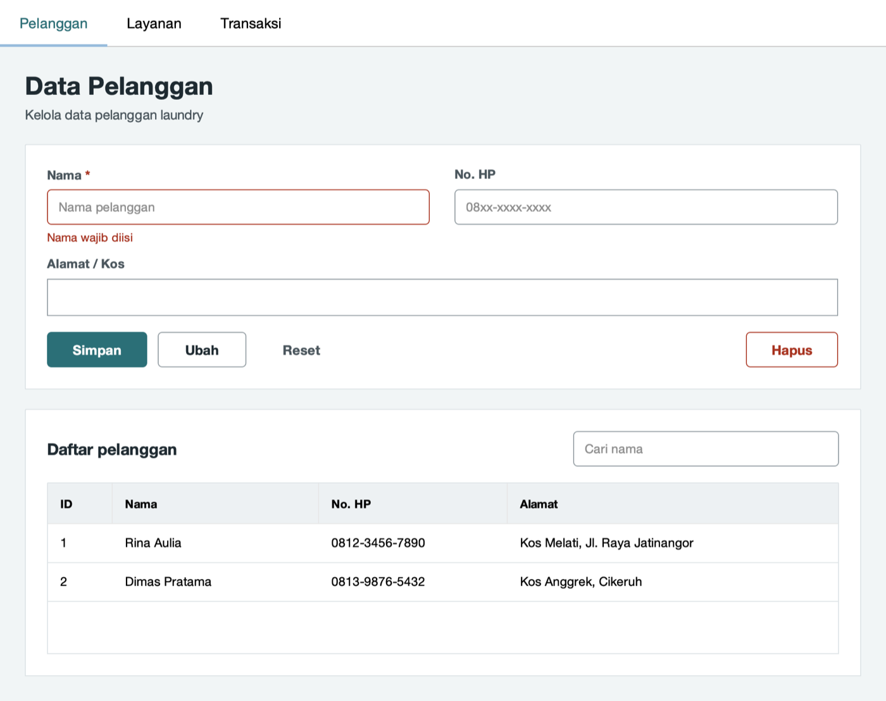
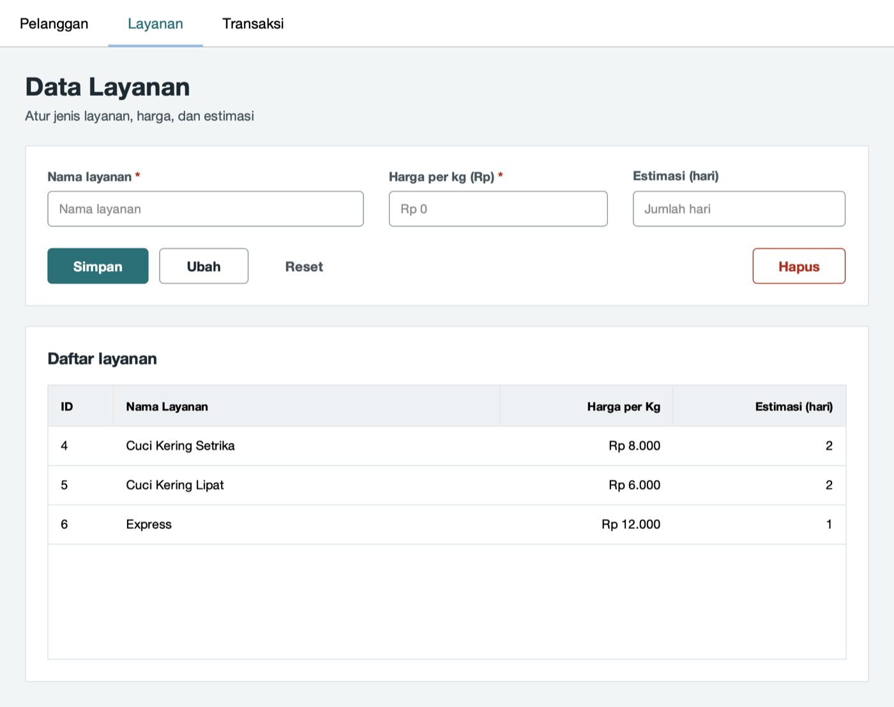
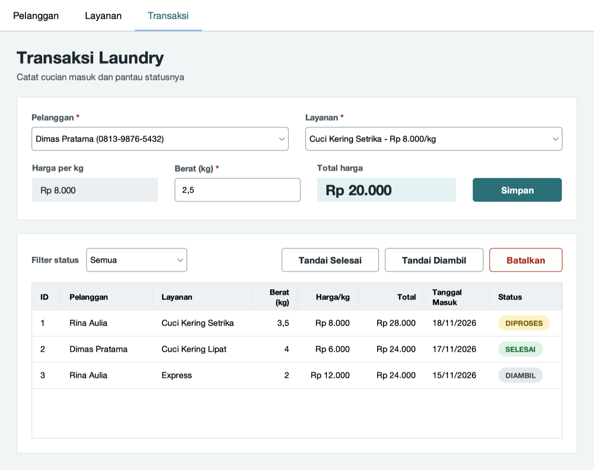
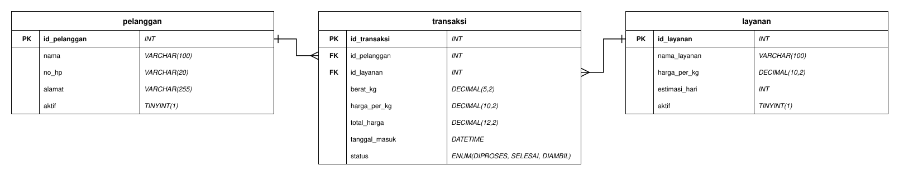

# Aplikasi Laundry Kiloan Jatinangor

Aplikasi desktop **Java Swing + MySQL** untuk mencatat pelanggan, layanan, dan transaksi pada usaha laundry kiloan.

**Mata kuliah:** Praktikum Pemrograman Berbasis Objek
**Kelompok:** 140810250004 - 140810250058 - 140810250100

---

## Masalah

Jatinangor dihuni banyak mahasiswa, sehingga usaha laundry kiloan sangat banyak dan permintaannya stabil. Namun banyak UMKM laundry masih mencatat order secara manual di buku nota. Pencatatan manual menimbulkan beberapa masalah:

- nota hilang atau tulisan tidak terbaca,
- total harga salah hitung,
- sulit mengecek cucian milik siapa yang sudah selesai atau belum diambil,
- sulit merekap data pelanggan dan transaksi.

## Tujuan

1. Mencatat data pelanggan dan jenis layanan secara rapi di database MySQL.
2. Menghitung total biaya secara otomatis (**berat × harga per kg**) sehingga tidak ada salah hitung.
3. Memantau status cucian dengan urutan yang jelas: **Diproses → Selesai → Diambil**.
4. Menampilkan riwayat transaksi yang bisa dicari dan difilter berdasarkan status.

## Fitur

| No | Fitur | Keterangan |
|----|-------|------------|
| 1 | Kelola Pelanggan | Tambah, ubah, hapus, dan cari pelanggan berdasarkan nama (pencarian langsung saat mengetik). |
| 2 | Kelola Layanan | Tambah, ubah, dan hapus jenis layanan beserta harga per kg dan estimasi hari pengerjaan. |
| 3 | Input Transaksi | Pilih pelanggan dan layanan, isi berat (boleh pakai koma, contoh `3,5`); harga dan total muncul otomatis. |
| 4 | Riwayat Transaksi | Tabel semua transaksi dengan label status berwarna, bisa difilter per status. |
| 5 | Ubah Status | Tombol **Tandai Selesai** dan **Tandai Diambil**; status tidak bisa dilompati. |
| 6 | Batalkan Transaksi | Menghapus transaksi yang salah input (transaksi yang sudah diambil tidak bisa dibatalkan). |
| 7 | Validasi Input | Isian wajib yang kosong atau salah format diberi garis merah dan pesan di bawahnya. |
| 8 | Hapus Aman | Pelanggan/layanan yang sudah punya transaksi hanya **dinonaktifkan**, sehingga riwayat transaksi tetap utuh. |
| 9 | Database Otomatis | Saat pertama kali dijalankan, database `db_laundry`, ketiga tabel, dan data awal layanan dibuat otomatis. |

### Tampilan

**Tab Pelanggan**: form data pelanggan dan daftar pelanggan dengan kolom pencarian.

**Validasi input**: isian wajib yang kosong diberi garis merah dan pesan.

**Tab Layanan**: jenis layanan, harga per kg, dan estimasi hari.

**Tab Transaksi**: total harga dihitung otomatis; status ditampilkan sebagai label berwarna.

---

## Tabel Relasional

Database bernama **`db_laundry`** dan terdiri dari **3 tabel**: `pelanggan`, `layanan`, dan `transaksi`.

Keterangan notasi: **PK** = Primary Key, **FK** = Foreign Key. Pada garis relasi, tanda garis tegak **|** berarti *satu (one)* dan tanda bercabang tiga (*crow's foot*) berarti *banyak (many)*.

> File diagram dibuat dengan **draw.io**: [`docs/erd-db_laundry.drawio`](docs/erd-db_laundry.drawio). Buka di aplikasi draw.io atau [app.diagrams.net](https://app.diagrams.net) untuk mengedit atau mengekspor ke PNG/PDF.

### Relasi

| Relasi | Jenis | Penjelasan |
|--------|-------|------------|
| `pelanggan` → `transaksi` | **1 : N** | Satu pelanggan dapat memiliki banyak transaksi; setiap transaksi dimiliki tepat satu pelanggan (`transaksi.id_pelanggan`). |
| `layanan` → `transaksi` | **1 : N** | Satu layanan dapat dipakai di banyak transaksi; setiap transaksi memakai tepat satu layanan (`transaksi.id_layanan`). |

### Struktur Tabel

**Tabel `pelanggan`**

| Kolom | Tipe | Keterangan |
|-------|------|------------|
| `id_pelanggan` | INT, **PK**, AUTO_INCREMENT | Identitas pelanggan |
| `nama` | VARCHAR(100), NOT NULL | Nama pelanggan |
| `no_hp` | VARCHAR(20) | Nomor HP |
| `alamat` | VARCHAR(255) | Alamat / kos |
| `aktif` | TINYINT(1), default 1 | 1 = aktif, 0 = dinonaktifkan |

**Tabel `layanan`**

| Kolom | Tipe | Keterangan |
|-------|------|------------|
| `id_layanan` | INT, **PK**, AUTO_INCREMENT | Identitas layanan |
| `nama_layanan` | VARCHAR(100), NOT NULL | Contoh: Cuci Setrika |
| `harga_per_kg` | DECIMAL(10,2), NOT NULL | Harga per kilogram |
| `estimasi_hari` | INT, default 2 | Perkiraan lama pengerjaan |
| `aktif` | TINYINT(1), default 1 | 1 = aktif, 0 = dinonaktifkan |

**Tabel `transaksi`**

| Kolom | Tipe | Keterangan |
|-------|------|------------|
| `id_transaksi` | INT, **PK**, AUTO_INCREMENT | Identitas transaksi |
| `id_pelanggan` | INT, **FK** → `pelanggan` | Pemilik cucian |
| `id_layanan` | INT, **FK** → `layanan` | Layanan yang dipilih |
| `berat_kg` | DECIMAL(5,2), NOT NULL | Berat cucian |
| `harga_per_kg` | DECIMAL(10,2), NOT NULL | **Salinan** harga saat transaksi dibuat, agar riwayat tidak berubah bila harga layanan diubah |
| `total_harga` | DECIMAL(12,2), NOT NULL | `berat_kg × harga_per_kg` |
| `tanggal_masuk` | DATETIME | Waktu order dibuat |
| `status` | ENUM('DIPROSES','SELESAI','DIAMBIL') | Status cucian |
